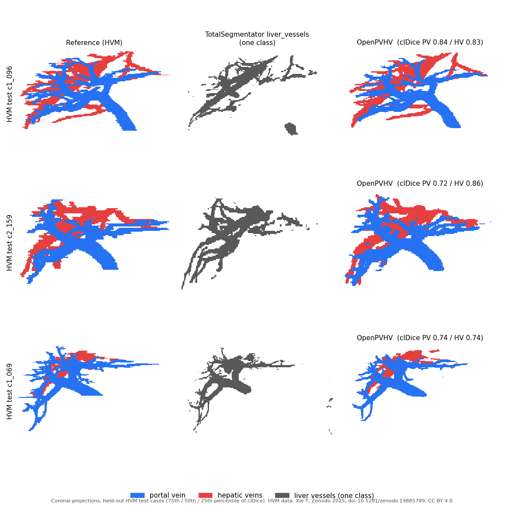

# OpenPVHV

Open portal vein / hepatic vein segmentation for CT — nnU-Net model trained only on public data (HVM), TotalSegmentator-compatible.

> Research use only. **Not a medical device**; not for diagnosis or treatment decisions.

**OpenPVHV is an add-on task for [TotalSegmentator](https://github.com/wasserth/TotalSegmentator) (v2.18) that replaces the
single-class `liver_vessels` output with separate portal vein and hepatic vein labels.** The vessel model was trained only on
HVM; the liver crop uses TotalSegmentator's `total` model (6 mm, Apache-2.0), exactly as TotalSegmentator's `liver_vessels`
task does. It is a drop-in replacement for TotalSegmentator's `liver_vessels` task, developed independently of the
TotalSegmentator authors (not an official TotalSegmentator task).

The vessel model is an nnU-Net v2 model that segments the intrahepatic **portal vein (label 1)** and **hepatic veins (label 2)**
in contrast-enhanced CT. It was trained from random initialisation on the public
[Hepatic Vessel Map (HVM)](https://doi.org/10.1038/s41597-026-07550-3) dataset (CC BY 4.0) only, with the same nnU-Net
configuration (plans) as `liver_vessels`. The pipeline is that of `liver_vessels`: the liver is found with TotalSegmentator's
6 mm `total` model, the CT is cropped to the liver + 20 mm, and the vessel model runs on the crop. Code and weights: Apache
License 2.0.



*Held-out HVM test cases (75th / 50th / 25th percentile of clDice): reference, TotalSegmentator `liver_vessels` (one class) and
OpenPVHV (portal vein blue, hepatic veins red), coronal projections. HVM data: Xie T, Zenodo 2025, doi:10.5281/zenodo.19885789,
CC BY 4.0.*

## Output
| Label | Structure |
|---|---|
| 0 | background |
| 1 | portal vein (intrahepatic, with the portal trunk inside the crop) |
| 2 | hepatic veins (intrahepatic; the inferior vena cava is **not** segmented) |

The label map is on the grid of the input CT (same shape and affine), uint8.

## Install
Python 3.10–3.11 with PyTorch, then
```
pip install -r requirements.txt        # TotalSegmentator 2.18.0, nnunetv2 2.7.0
```
Download the weights (`OpenPVHV_weights.zip`, 229 MB) from Zenodo, https://doi.org/10.5281/zenodo.23619753, and check
its SHA-256:
```
c775a4d054c553d0a40d3c3fff05942dc24561ac5698e8263c885cd31a914b1b  OpenPVHV_weights.zip
```
Unzip it anywhere; it contains `Dataset950_HVM_PVHV/nnUNetTrainer__nnUNetPlansScratch__3d_fullres/`
(`plans.json`, `dataset.json`, `fold_all/checkpoint_final.pth`).

## Run
```
python pvhv_predict.py -i ct.nii.gz -o pv_hv.nii.gz \
    -m <unzipped>/Dataset950_HVM_PVHV/nnUNetTrainer__nnUNetPlansScratch__3d_fullres
```
Options: `--device cuda|cpu|mps` (default `cuda`), `--crop 6mm|1.5mm` (model used to find the liver, default `6mm` as in
TotalSegmentator; the paper's evaluation uses 6 mm), `--info info.json` (crop, volumes, timing), `--no-download`.
On first use TotalSegmentator downloads its crop model (task 298, about 70 MB) under its own license.

From Python:
```python
import nibabel as nib, pvhv_predict
seg, info = pvhv_predict.predict(nib.load("ct.nii.gz"), "<model dir>", crop="6mm", device="cuda")
nib.save(seg, "pv_hv.nii.gz")
```

## Pipeline
1. Liver for the crop: TotalSegmentator `total` 6 mm model (task 298; `--crop 1.5mm`: task 291), no test-time augmentation.
2. Crop: liver bounding box + 20 mm on each axis (TotalSegmentator's `crop_addon` for `liver_vessels`).
3. This model: nnU-Net 3d_fullres (PlainConvUNet, 6 stages), 1.5 × 0.8 × 0.8 mm, patch 64 × 192 × 192, sliding window step 0.5
   with Gaussian weighting, no mirroring, no postprocessing; result put back on the input grid.

If the crop model finds no liver, the output is empty (as in TotalSegmentator); a warning is printed.

## Training data and training
- HVM: two centres, portal venous phase CT. 280 cases paired one-to-one (see `NOTICE` for how the annotation files were matched
  to the images); 224 for training, 56 held out (20 % of each centre, seed 20261011).
- nnU-Net v2 2.7.0, configuration (plans) of TotalSegmentator `liver_vessels` used unchanged, random initialisation,
  1000 epochs, fold `all` (all 224 training cases), default nnU-Net loss, optimiser and augmentation. One NVIDIA RTX 4070.
- Details: [MODEL_CARD.md](MODEL_CARD.md).

## Evaluation
VEELA 2025 challenge evaluation code (clDice, IoU, NSD; voxel spacing (3, 2, 1) mm and NSD tolerance 1 mm as fixed in that code),
the same code for every data set. HVM and VEELA public: prediction and reference restricted to the liver mask of the crop model
grown by 10 mm; VEELA hidden: the organisers' evaluation of the submitted outputs. Mean clDice:

| Data | Portal vein | Hepatic vein |
|---|---|---|
| HVM held-out test (56) | 0.750 | 0.786 |
| VEELA public training set (20, external) | 0.723 | 0.662 |
| VEELA hidden test set (20, external; challenge evaluation) | 0.734 | 0.732 |

IoU, NSD, the comparison with TotalSegmentator `liver_vessels` and with VoxTell, and the statistics are in the paper.
VEELA counts the intrahepatic inferior vena cava as hepatic vein; OpenPVHV does not segment it (see Limitations).

### Reproducing the paper's predictions
`evaluation/predict_eval_sets.py` runs `pvhv_predict.predict()` with the settings above on each evaluation set, one case at a
time, and writes one label map, one JSON per case (crop, voxel counts, time), and `run.json` (versions, hashes). The images are not
part of this repository. Obtain HVM from Zenodo (10.5281/zenodo.19885789) and VEELA from the challenge organisers.
The 56 held-out HVM cases are listed in `evaluation/hvm_split.json`. `evaluation/hvm_pairs.json` maps each case to its HVM image
and annotation files. `evaluation/crlm_train951_cases.csv` lists the 80 TCIA Colorectal-Liver-Metastases cases (slice thickness
<= 2.5 mm) considered for the HVM + CRLM comparison model of the paper (not the released model): 62 used for training, 18 excluded,
with the reason (case IDs and numbers only; no images or annotations).
```
M=<unzipped>/Dataset950_HVM_PVHV/nnUNetTrainer__nnUNetPlansScratch__3d_fullres
python evaluation/predict_eval_sets.py hvm_test    6mm out/hvm_6mm   --model-dir $M --hvm-dir "<HVM Dataset>"
python evaluation/predict_eval_sets.py veela_train 6mm out/veela_6mm --model-dir $M --veela-dir "<VEELA folder>"
```
`<HVM Dataset>` contains `Center 1` and `Center 2`. `<VEELA folder>` contains `VEELA Train Set` and/or `VEELA Test Set`; the
VEELA hidden test set is `veela_test`. The second argument is the crop model (`6mm` as in the paper, or `1.5mm`).
Crop-model weights are not downloaded by this script (run `pvhv_predict.py` or TotalSegmentator once first).

## Limitations
See [MODEL_CARD.md](MODEL_CARD.md#limitations): no inferior vena cava; the liver crop can fail in severe fatty liver;
thin peripheral branches may be missed; trained on portal venous phase CT from two centres.

## Citation
Paper (original article):

> Meidai Kasai. Separating portal and hepatic veins on CT with a TotalSegmentator-compatible model trained only on public data:
> external validation and release. 2026.

Weights: Meidai Kasai. OpenPVHV model weights (nnU-Net Dataset950_HVM_PVHV). Zenodo; 2026.
https://doi.org/10.5281/zenodo.23619753

Please also cite the training data, TotalSegmentator and nnU-Net (full references in `NOTICE`):

- HVM paper: Xie T, et al. Hepatic Vessel Map (HVM): an expert-annotated CT dataset for clinically applicable AI in liver vascular
  segmentation and surgical planning. Sci Data. 2026;13:1259. https://doi.org/10.1038/s41597-026-07550-3
- HVM data: Xie T. Hepatic Vessel Map (HVM) [Dataset]. Zenodo; 2025. https://doi.org/10.5281/zenodo.19885789 (CC BY 4.0)
- TotalSegmentator: Wasserthal J, et al. Radiol Artif Intell. 2023;5(5):e230024. https://doi.org/10.1148/ryai.230024
- nnU-Net: Isensee F, et al. Nat Methods. 2021;18:203–211. https://doi.org/10.1038/s41592-020-01008-z

## License
Code and weights: Apache License 2.0 (`LICENSE`). Training data: HVM, CC BY 4.0 (attribution in `NOTICE`).
Author: Meidai Kasai (Independent Researcher).
